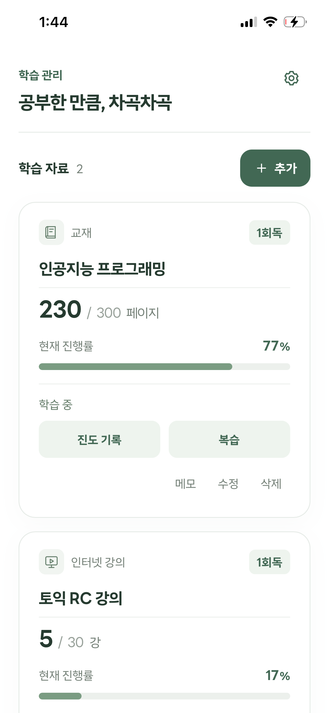
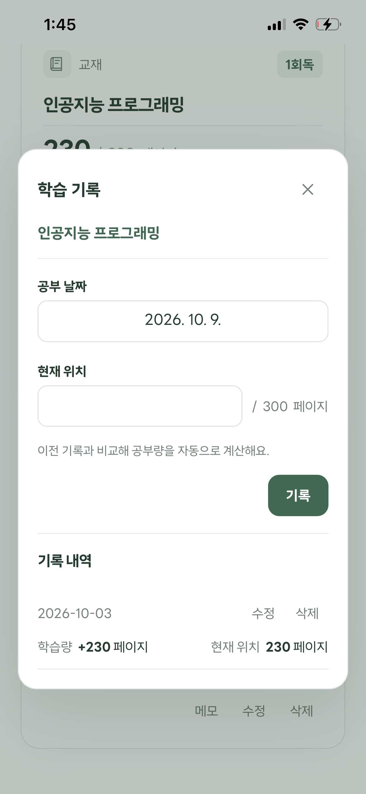

# 학습 진도 관리 앱

## 1. 제작한 것 소개

### 제작 배경과 목적

전공 공부와 다양한 시험 준비를 병행하면서 여러 학습 자료의 진행 상황을 정확히 파악하고 관리하기 어렵다는 문제에서 출발했습니다. 복잡한 학습 계획을 세우기보다는 **공부를 마친 뒤 현재 진도를 간편하게 기록하고, 전체적인 학습 진행률과 현황을 한눈에 확인할 수 있도록** 기획했습니다.

### 주요 기능

- **학습 자료 관리:** 자료명, 유형, 학습 단위, 전체 분량 등록·수정·삭제
- **학습 진도 기록:** 공부 날짜와 도달 위치 기록, 공부량 및 진행률 계산, 기록 수정·삭제
- **회독 관리:** 회독 완료 표시, 다음 회독 시작, 이전 회독별 기록 조회
- **복습 관리:** 날짜와 복습 시작·끝 위치 기록, 수정·삭제 및 횟수 집계. 전체 진도와 회독에는 영향을 주지 않음
- **진행 현황 확인:** 자료별 진행량·진행률·회독을 카드와 진행률 막대로 표시
- **로컬 저장:** 브라우저 LocalStorage를 활용한 기록 유지

### 앱 실행 화면

<table>
  <tr>
    <th>메인 화면</th>
    <th>학습 진도 기록</th>
    <th>부분 복습 기록</th>
  </tr>
  <tr>
    <td></td>
    <td></td>
    <td></td>
  </tr>
</table>

---

## 2. PRD — 프로젝트 요구사항 정의서

### 0. AI 개발 담당자에게 보내는 요청

1. 아래 요구사항을 읽고 이해한 내용을 3~5줄로 요약해 확인받습니다.
2. 불명확하거나 결정이 필요한 부분은 작업 시작 전에 질문합니다.
3. 확인 이후 단계별 구현 계획을 제시하고, 승인받은 뒤 개발합니다.
4. **범위 제외 기능은 별도 요청 전까지 구현하지 않습니다.**

### 1. 프로젝트 개요

- **프로젝트 이름:** 학습 진도 관리 앱
- **한 줄 소개:** 학습 상황을 기록하고 한눈에 확인할 수 있도록 하는 앱
- **만드는 사람:** 개인 프로젝트
- **완성 목표:** 수업 과제 제출일까지

### 2. 제작 목적

자격증과 여러 시험을 준비하면서 학습 자료가 다양해졌고, 각 자료의 진행 상황을 한눈에 파악하기 어려워졌습니다. 이를 해결하기 위해 학습 내용을 정리하고 현재 진도와 반복 학습 정도를 쉽게 확인할 수 있는 앱을 제작합니다.

### 3. 대상 사용자

- **주 사용자:** 전공 공부, 시험, 자격증을 준비하는 대학생과 취업 준비생
- **사용 환경:** 스마트폰 및 PC 웹 브라우저
- **사용 특성:** 계획을 복잡하게 세우기보다 공부 후 빠르게 기록하고 전체 현황을 확인하고자 함

#### 3-1. 대표 사용자 페르소나

- **이름/나이:** 김민지 / 23세 대학생
- **상황:** 전공 시험과 자격증을 준비하며 교재, 문제집, 인터넷 강의를 반복 학습
- **바라는 점:** 얼마나 진행했는지, 몇 번 반복했는지 쉽게 확인
- **불편한 점:** 복잡하고 번거로운 공부 기록 과정

### 4. 핵심 기능

#### 4-1. 학습 자료 등록·관리

- 자료 이름 등록
- 학습 유형 선택: **교재, 문제집, 인터넷 강의, 단어 학습, 기타**
- 유형에 따른 학습 단위 선택
  - 교재/책: `Page`, `Chapter`
  - 문제집: `Page`, `문제`
  - 인터넷 강의: `강`, `Chapter`
  - 단어 학습: `단어`, `Day`
  - 기타: 사용자 직접 입력
- 전체 학습 분량 입력
- 자료 수정 및 삭제

#### 4-2. 학습 진도 기록·확인

- 현재 공부 위치와 공부 날짜 입력
- 이전 위치와 현재 위치의 차이로 공부량 계산
- 현재 진행량, 진행률 및 회독 횟수 표시
- 날짜별 학습 기록 확인
- 학습 기록 수정·삭제 시 진행 상황 재계산

#### 4-3. 회독 관리

- 전체 분량 학습 시 현재 회독 완료 상태 표시
- 완료한 회독의 기록 유지
- 다음 회독을 진도 0부터 시작
- 회독별 진행 상황 및 기록 확인

#### 4-4. 부분 복습 관리

- 자료별로 **복습 날짜, 시작 위치, 끝 위치** 기록
- 입력한 복습 구간이 자료의 전체 범위 안에 있는지 확인
- 부분 복습 기록 조회·수정·삭제
- **기록 1건을 부분 복습 1회로 집계**
- 부분 복습은 별도 기록으로 관리하며, **전체 진도·진행률·회독 횟수를 변경하지 않음**

### 5. 범위 제외 — 이번 버전에서 만들지 않는 기능

- 공부시간 측정 타이머
- 하루 권장 학습량 자동 계산
- 회원가입 및 로그인
- 서버 기반 데이터 동기화
- 알림 및 푸시 알림

### 6. 디자인 방향

- 깔끔하고 차분한 학습 관리 화면
- 화이트 배경, 세이지/그린 계열 포인트 색상
- **LINE Seed Sans KR** 폰트
- 둥근 카드, 적절한 여백, 부드러운 그림자
- 진행률을 보여주는 Progress Bar
- 모바일에서도 누르기 쉬운 버튼 크기
- 장식보다 학습 현황 정보의 가독성 우선

### 7. 기술 조건

- HTML, CSS, JavaScript 기반 반응형 웹앱
- 브라우저 LocalStorage 저장
- 새로고침 및 브라우저 재실행 후 기록 유지
- 스마트폰·PC 양쪽에서 화면과 기능 정상 동작
- 모바일 우선 설계

### 8. 기본 가정

- 자료별 전체 학습 분량은 숫자로 표현할 수 있음
- 하나의 자료는 하나의 학습 유형과 단위를 사용함
- 선택 유형에 적합한 학습 단위를 제공함
- 기타 유형은 직접 단위 입력 가능
- 회독은 자료 전체 범위를 한 번 학습한 것을 뜻함
- 공부 후 사용자가 현재 위치를 직접 입력함
- 로그인이나 여러 기기 간 실시간 공유는 필요하지 않음

### 9. 결정한 사항과 검토할 점

**이번 구현 계획에서 채택한 사항**

- 진도는 `+30` 같은 증가량보다 **현재 도달 위치를 직접 입력**하는 방식 사용
- 부분 복습을 별도로 기록하며 1건을 1회로 계산
- 회독 완료 시 100% 상태를 유지하고 **다음 회독 시작** 버튼 제공

**추가 검토가 필요한 세부 사항**

- 과거 학습 기록을 수정할 때 날짜가 뒤섞인 경우 진도를 재계산하는 규칙
- 기록 수정·삭제로 완료된 회독의 전체 분량 도달 상태가 달라질 때 처리 방식
- 전체 분량 또는 단위 수정 시 기존 기록을 어떻게 유지할지

### 10. 완성 기준

- [ ] 자료 등록·수정·삭제가 가능하다.
- [ ] 유형별 학습 단위를 선택하고 기타 단위를 직접 입력할 수 있다.
- [ ] 진도 기록을 추가·수정·삭제할 수 있다.
- [ ] 진행량과 진행률이 정확히 계산된다.
- [ ] 현재 회독 수가 표시된다.
- [ ] 완료 후 다음 회독을 시작할 수 있다.
- [ ] 이전 회독 기록이 유지되고 조회된다.
- [ ] 여러 자료의 진행 상황을 한눈에 확인할 수 있다.
- [ ] 부분 복습을 날짜와 시작·끝 위치로 등록·수정·삭제할 수 있다.
- [ ] 부분 복습 횟수가 정확하며 기존 진도·회독에 영향을 주지 않는다.
- [ ] 브라우저 재실행 후 데이터가 유지된다.
- [ ] 스마트폰과 PC에서 주요 기능이 정상 동작한다.

---

## 3. TODO 리스트 — 단계별 개발 계획

> 체크박스는 실제 구현과 검증을 마친 뒤에만 완료 처리합니다. 단계별로 결과를 확인받고 다음 단계로 진행합니다.

### 1단계. 기본 화면과 디자인

- [ ] 1-1. 화이트 배경과 세이지/그린 포인트 색상 적용
- [ ] 1-2. LINE Seed Sans KR 폰트 적용
- [ ] 1-3. 자료명·회독·진행량·진행률 카드 제작
- [ ] 1-4. 카드에 Progress Bar 표시
- [ ] 1-5. 자료 등록 버튼 배치
- [ ] 1-6. 모바일·PC 반응형 레이아웃 적용

**확인:** 예시 자료 카드와 버튼이 모바일에서도 잘리지 않고 정보가 읽히는지 확인

### 2단계. 자료 등록·수정·삭제

- [ ] 2-1. 자료 이름 입력란
- [ ] 2-2. 5개 학습 유형 선택란
- [ ] 2-3. 유형별 단위 선택지
- [ ] 2-4. 기타 유형 직접 단위 입력
- [ ] 2-5. 전체 분량 입력란
- [ ] 2-6. 자료 목록 추가
- [ ] 2-7. 자료 수정
- [ ] 2-8. 자료 삭제

**확인:** `토익 문제집 / 문제집 / 문제 / 1,000` 등록 후 유형·단위 변경 및 수정·삭제 결과 확인

### 3단계. 진도 입력과 학습 기록

- [ ] 3-1. 자료별 학습 기록 화면
- [ ] 3-2. 공부 날짜 입력
- [ ] 3-3. 현재 위치 입력
- [ ] 3-4. 이전 위치와 차이로 공부량 계산
- [ ] 3-5. 0~전체 분량 범위 검사
- [ ] 3-6. 진행량 및 진행률 카드 반영
- [ ] 3-7. 날짜·도달 위치·공부량 기록 목록
- [ ] 3-8. 학습 기록 수정
- [ ] 3-9. 학습 기록 삭제
- [ ] 3-10. 수정·삭제 후 진도 재계산

**확인:** 전체 200페이지에서 50→80페이지 기록 시 공부량 30페이지·진행률 40%, 최신 기록 삭제 후 50페이지·25% 확인

### 4단계. 회독 완료와 다음 회독

- [ ] 4-1. 새 자료를 1회독으로 시작
- [ ] 4-2. 전체 분량 도달 시 회독 완료 표시
- [ ] 4-3. 완료 상태의 진행률 100% 유지
- [ ] 4-4. 다음 회독 시작 버튼 표시
- [ ] 4-5. 다음 회독 진도 0부터 시작
- [ ] 4-6. 이전 회독 학습 기록 보존
- [ ] 4-7. 회독별 진행 상황 및 기록 조회

**확인:** 1회독 완료 후 100% 유지, 2회독 시작 시 0%로 전환되면서 1회독 기록 보존

### 5단계. 부분 복습과 데이터 저장

- [ ] 5-1. 자료별 부분 복습 화면
- [ ] 5-2. 복습 날짜 입력
- [ ] 5-3. 복습 시작·끝 위치 입력
- [ ] 5-4. 복습 범위 유효성 검사
- [ ] 5-5. 부분 복습 기록 목록
- [ ] 5-6. 기록 건수로 부분 복습 횟수 표시
- [ ] 5-7. 부분 복습 기록 수정
- [ ] 5-8. 부분 복습 기록 삭제
- [ ] 5-9. 부분 복습과 전체 진도·회독 분리
- [ ] 5-10. 모든 데이터를 LocalStorage에 저장
- [ ] 5-11. 앱 재실행 시 데이터 불러오기

**확인:** 20~40페이지 복습 기록이 1회로 집계되고 기존 진도는 유지되는지, 새로고침 후 기록이 남는지 확인

### 6단계. 최종 기능 검수

- [ ] 6-1. 자료 등록·수정·삭제
- [ ] 6-2. 유형별 단위 선택
- [ ] 6-3. 기타 유형 직접 단위 표시
- [ ] 6-4. 진도 기록·수정·삭제
- [ ] 6-5. 진행량·진행률 계산 정확성
- [ ] 6-6. 현재 회독 표시
- [ ] 6-7. 회독 완료 후 다음 회독 시작
- [ ] 6-8. 이전 회독 기록 보존
- [ ] 6-9. 여러 자료의 진행 상황 확인
- [ ] 6-10. 브라우저 재실행 후 저장 상태
- [ ] 6-11. 모바일·PC 기능 점검
- [ ] 6-12. 부분 복습 등록·수정·삭제 및 횟수 집계
- [ ] 6-13. 부분 복습 후 전체 진도·회독 유지

**확인:** 자료 등록 → 진도 기록 → 수정·삭제 → 회독 완료 → 다음 회독 → 부분 복습 → 재실행 순서로 통합 점검

### 구현하지 않는 항목

- [ ] 제외-1. 공부시간 측정 타이머 — 구현하지 않음
- [ ] 제외-2. 하루 권장 학습량 자동 계산 — 구현하지 않음
- [ ] 제외-3. 회원가입·로그인 — 구현하지 않음
- [ ] 제외-4. 서버 기반 데이터 동기화 — 구현하지 않음
- [ ] 제외-5. 알림·푸시 알림 — 구현하지 않음

---

## 4. 방법론 비교 — TODO 리스트 방식 vs PRD 방식

| 비교 항목 | TODO 리스트 방식 | PRD 방식 |
| --- | --- | --- |
| **장점** | • 작업별로 구현된 기능과 누락된 기능을 명확하게 파악할 수 있음 • 단계마다 작업물을 확인할 수 있어 개발 진행 상황을 파악하기 쉬움 • 각 단계에서 피드백을 반영해 개발 방향이 크게 어긋나는 것을 방지할 수 있음 • 필요한 기능을 단계적으로 구현하고 점검할 수 있음 | • 기획을 미리 구체화하고 문서화해 프로젝트의 전체적인 상황을 파악하기 쉬움 • 변경 사항이 발생해도 기존 요구사항과 수정 내용을 추적·관리하기 편리함 • 전체적인 구조가 정리되어 있어 새로운 기능이나 개선 방향을 구상하기 쉬움 • 초기 기획 이후에는 수정 방향이 명확해져 개발을 더 빠르고 효율적으로 진행할 수 있음 |
| **단점** | • 단계마다 작업물을 확인하고 피드백하는 과정이 반복되어 전체 개발 시간이 길어짐 • 개별 작업에 집중하다 보면 프로젝트의 전체적인 방향을 놓칠 수 있음 • 전체 구조가 완성되기 전에 세부 사항을 수정해 불필요한 작업이 발생할 수 있음 • 앞선 단계의 수정 내용이 이후에는 필요하지 않거나 재수정해야 하는 경우가 생김 | • 필요한 기능과 불필요한 기능을 구분하고 구체화하는 데 많은 시간이 필요함 • 디자인과 사용 흐름까지 미리 고려해야 해 기획 난도가 높음 • 완성될 프로그램의 전체적인 모습을 사전에 상상하고 설계하는 것이 어려움 |

---

## 5. 각 방법론의 개선할 점

| 비교 항목 | TODO 리스트 방식 | PRD 방식 |
| --- | --- | --- |
| **개선할 점** | • 개발 초기 전체적인 구조와 핵심 기능을 간단히 정의하여 작업 방향 유지 • 단계를 지나치게 세분화하지 않고 관련 작업을 묶어 진행해 확인·피드백 시간 단축 • 세부 디자인 수정은 전체 기능과 구조가 어느 정도 완성된 뒤 진행해 불필요한 재작업 최소화 • 단계별 결과를 검토할 때 개별 기능뿐 아니라 전체 프로젝트와의 연관성도 함께 확인 | • 처음부터 모든 기능을 상세하게 설계하기보다 핵심 구조와 필수 요구사항 위주로 기획해 초기 준비 시간 단축 • 반드시 지켜야 할 제약 조건은 명확히 하되 세부 기능 구성과 디자인에는 AI의 자율성 활용 • AI가 제안한 결과물을 확인하고 피드백하면서 요구사항을 점진적으로 구체화 • 초기 PRD를 고정된 설계가 아닌 개발 과정에서 지속적으로 보완하는 문서로 활용 |

---

## 6. 결론

이번 프로젝트에서는 학습 진도 관리 앱을 제작하며 TODO 리스트와 PRD 방식의 장단점을 직접 경험할 수 있었습니다.

개발 과정에서 요구사항을 너무 간단하게 전달하면 의도와 다른 결과가 나오기도 했고, 반대로 지나치게 구체적으로 지정하면 오히려 AI의 능력을 충분히 활용하지 못한다는 느낌을 받았습니다.

이러한 경험을 통해 바이브코딩에서는 단순히 AI에게 명령을 잘 내리는 것뿐만 아니라, AI가 잘할 수 있는 부분을 파악하고 적절하게 활용하는 능력도 중요하다는 것을 느꼈습니다. 
