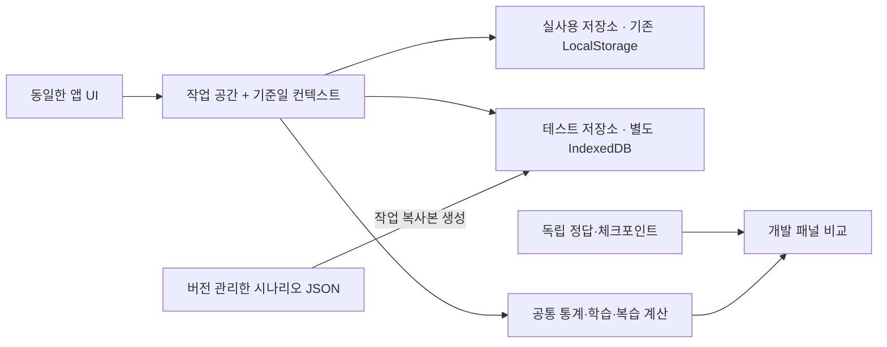

> 과거 제안 기록입니다. 최신 사용자 요청으로 다중 시나리오·별도 개발 앱은 제거했습니다. 현재 기능은 [OFF/ON 안내](developer-test-data-implementation.md)를 참고하세요.

# 개발자용 테스트 데이터 시스템 제안

2026-10-26. **기획·읽기 전용 호환성 확인만 수행했다. 앱 코드, 저장 구조, 실제 데이터와 배포본은 변경하지 않았다.** 아래 저장소·UI·정책은 승인 전 제안이며, 데이터 생성기와 테스트 모드는 아직 구현하지 않았다.

## 1. 권장안과 두 방식 비교

권장안은 **기존 백업 형식의 재현 가능한 데이터 세트 + 독립된 개발자 테스트 모드**다. 실사용 LocalStorage를 다른 기술로 옮기지 않고 유지하며, 테스트 작업 공간만 별도의 IndexedDB에 저장하는 방식을 제안한다.

| 항목 | JSON 파일만 사용 | JSON + 독립 개발자 모드 |
| --- | --- | --- |
| 초기 구현 난이도 | 낮음. 생성기·정답표·파일 배포 중심 | 중~높음. 저장소 전환·기준일·내보내기·비동기 충돌 검증 필요 |
| 원본 안전성 | 현재 복원 기능에 넣으면 현재 자료를 교체하므로 별도 브라우저 프로필/개발 주소가 필요 | 실사용/테스트 저장 경로를 나누고 전환 시 복사·합병하지 않음 |
| 날짜 재현성 | 실제 날짜가 지나면 권장량·지연 상태가 달라짐 | 시나리오 기준일을 고정하고 다음 날로 진행 가능 |
| iPhone/PWA 조작 | 파일 선택·복원을 반복해야 함 | 설정에서 시나리오 선택·계속하기·처음부터·정답 확인 |
| 전환·일정 변경 검증 | 최종 상태 JSON만으로 과정 검증은 어려움 | 단계별 조작과 체크포인트로 전후 상태 비교 |
| 유지보수 | 파일만 만들기는 쉬우나 수동 재현 비용이 큼 | 초기 비용은 크지만 같은 데이터·정답·계산 코드를 PC와 iPhone에서 재사용 |
| 대량 기록 | 실사용 LocalStorage에 넣으면 저장 한도·동기 처리 영향을 받음 | 테스트 전용 IndexedDB로 분리하되 실제 계산/화면 성능은 그대로 측정 |
| 권장 용도 | 작은 계산 기준 세트·자동 검증·초기 준비 | 장기 이력·반복 조작·실기기·전환 안전성 검증 |

LocalStorage는 동기식이고 origin 기준으로 구분된다. IndexedDB는 비동기 트랜잭션을 제공하므로 테스트 대량 저장에 적합하지만, 계산과 화면 렌더링까지 자동으로 빨라지는 것은 아니다. [MDN Web Storage](https://developer.mozilla.org/en-US/docs/Web/API/Web_Storage_API), [MDN IndexedDB](https://developer.mozilla.org/en-US/docs/Web/API/IndexedDB_API/Using_IndexedDB)

**격리 수준을 구분해야 한다.** 실사용 LocalStorage와 테스트 IndexedDB를 분리하면 앱의 읽기·쓰기 경로를 격리할 수 있다. 하지만 같은 origin에서는 사이트 데이터 삭제·브라우저 보관 정책의 영향을 함께 받을 수 있다. 보호를 최우선으로 하면 같은 코드의 **별도 개발 주소/개발 PWA**를 병행하는 편을 권장한다. 단순히 /dev/ 폴더로 나누는 것은 origin 분리가 아니다. [MDN localStorage](https://developer.mozilla.org/en-US/docs/Web/API/Window/localStorage)

별도 주소를 사용할 경우 실사용 주소의 자료가 개발 주소에 자동으로 나타나지 않는다. 각 주소의 기본 저장 공간은 별개이며, 원래 실사용 앱/PWA는 그대로 유지된다. 같은 앱 안에서 원본 화면과 테스트 화면을 오가고 싶다면 개발 기능을 켠 빌드에서 아래 저장소 전환을 사용한다. 이 배포 선택은 사용자 확인 후 확정한다.

## 2. 현재 코드에서 확인한 저장·백업 호환성

| 대상 | 현재 구조·동작 | 새 설계에서의 처리 |
| --- | --- | --- |
| 실사용 통합 저장 | chagok-v2-data-v1 | 이름·버전·내용 형식 유지 |
| 1.0 원본 | study-progress-data-v1 | 테스트 모드에서 자동으로 읽거나 쓰지 않음 |
| 이전 시험 저장 | chagok-v2-preview-exams-v1 | 실제 마이그레이션의 기존 읽기 경로만 유지 |
| 복구 사본 | chagok-v2-data-v1.before-recovery.* 등 | 테스트 복구와 완전히 다른 저장 경로 |
| 현재 백업 | app=chagok-v2, backupVersion=1, createdAt, data | 내부 payload를 그대로 재사용 |
| data 내용 | app=chagok-v2, version=1, study, exams | 자료·시험을 함께 보존하는 동일 envelope 사용 |
| 1.0 백업 | study-progress 백업Version1 포장형과 exportedAt 구형 | 테스트 공간의 복사본으로도 검증 가능 |
| 현재 복원 | 전체 통합 상태 교체. 1.0 파일은 기존 시험을 유지 | 개발 모드에서는 대상 작업 공간만 교체 |

중요한 현재 구현 지점:

- app.js 시작 부분에서 StudyData.load(window.localStorage, ...)를 바로 호출한다.
- StudyData.load는 통합 키가 없으면1.0/이전 시험 키를 읽고 새 통합 키를 쓸 수 있다.
- 저장·복구·충돌 감지도 window.localStorage와 고정 키를 직접 사용한다.
- 따라서 토글만 추가하거나 일반 키의 내용을 테스트 JSON으로 바꿨다가 되돌리는 방식은 권장하지 않는다. **첫 로딩보다 먼저 저장소 컨텍스트를 결정**해야 한다.
- StudyData.validate/update/backup/restore와 학습·복습·통계의 순수 계산 부분은 재사용 가능하다. 실사용 데이터 스키마를 테스트 때문에 바꿀 필요는 없다.
- IndexedDB는 현재 동기 StorageGuard를 그대로 사용할 수 없다. 테스트 저장소에는 revision 비교를 포함한 별도 트랜잭션 저장이 필요하다. 실사용 충돌 보호는 기존 동작을 유지한다.

이번에 실제 실행한 것은 합성 객체와 인메모리 저장소뿐이다. 현재2.0 백업 왕복,1.0 메모리 마이그레이션 시 원본 문자열 보존,1.0 복원 시 시험 유지, 개발 전용 app 표식 파일의 현재 복원기 거절을 확인했다. **새 개발 모드의 격리나 실기기 동작이 이미 검증됐다는 뜻은 아니다.**

## 3. 데이터 구조 제안

### 3-1. 세 종류를 분리

1. **변경하지 않는 기준 데이터:** 저장소에 포함된 시나리오 원본과 정답표.
2. **사용자가 조작하는 작업 공간:** 시나리오 복사본과 테스트 중 추가한 기록.
3. **정답·조작 단계:** 기준일, 입력 순서, 체크포인트별 기대값. 앱의 학습 자료 안에 섞지 않는다.

기존 백업 payload는 그대로 사용하고 다음 메타데이터를 별도로 관리한다.

| 필드 | 목적 |
| --- | --- |
| scenarioId / fixtureVersion | 시나리오 식별·형식 버전 |
| generatorVersion / seed | 같은 데이터를 다시 생성 |
| asOfDate | 재현 기준일. 기본 제안2026-10-26 |
| policyVersion / calculationHash | 계산 정책·모듈 변경 감지 |
| payloadHash / expectedHash | 데이터와 정답표가 맞는 조합인지 확인 |
| counts / byteSize | 자료·시험·기록 수와 실제 파일 크기 안내 |
| steps / checkpoints | 중단·재개·날짜 변경 등 과정 검증 |
| expected | 지표·범위·일정·경고별 독립 정답 |
| workspaceId / revision / dirty | 작업 복사본, 동시 저장 충돌, 변경 여부 |

자료 기록은 현재처럼 누적 position을 기준으로 만들고, 증가량은 직전 위치와 비교해 검증한다. 같은 회독에서 날짜·sequence 순서대로 위치가 감소하면 안 된다. roundHistory 길이는 round-1이고 완료된 과거 회독의 마지막 위치는 전체 분량과 일치해야 한다. ID·sequence·원본 날짜·단위·이해도·알 수 없는 기존 필드는 보존한다.

현재 스키마에는 시험 일정 변경이나 중단의 전체 사건 이력이 없다. 따라서 그런 이력을 임의의 새 학습 필드로 만들어 넣지 않고, **시나리오의 steps/checkpoints**에서 관리한다. 최종 JSON 하나를 불러오는 것과 실제 변경 과정을 검증하는 것을 구분한다.

### 3-2. 테스트 파일이 실사용 복원에 들어가는 것을 막기

일반 백업 형식과 똑같은 파일에 test=true만 붙이면 안전하지 않다. 현재 복원기는 그 표식을 검사하지 않는다.

권장 배포 형식은 다음과 같다. 이는 **구조 제안**이며 파일은 아직 생성하지 않았다.

- 시나리오 패키지: 바깥 app=chagok-dev-fixture, 안쪽 backup에 기존2.0 백업 객체.
- 테스트 중 내보내기: 바깥 app=chagok-dev-backup, 안쪽 backup에 기존2.0 백업 객체.
- 실사용 내보내기: 현재 app=chagok-v2 / backupVersion=1 그대로.

즉 **내부 백업 호환성을 유지하면서 바깥 식별자를 다르게** 한다. 현재2.0 복원기는 개발 전용 app 값을 거절하므로, 실사용 파일 선택기에 테스트 내보내기 파일을 넣어도 일반 백업으로 복원되지 않는다. 이름에도 TEST·시나리오·기준일을 표시한다.

기존 표준 백업 JSON을 그대로 만들 수 있는 생성기 출력은 자동 검증/격리 환경용으로 한정한다. 그 파일은 원래 정상 백업이므로 기존 앱이 구분 없이 복원할 수 있다는 한계가 있다. 개발자 UI의 기본 다운로드는 반드시 개발 전용 포장형으로 제안한다.

### 3-3. 테스트 전용 저장소

제안 DB 이름은 chagok-dev-test-v1이다.

- workspaces: workspaceId, revision, envelope, 시나리오/기준일/변경 메타데이터.
- checkpoints: 선택한 작업 공간의 비교·되돌리기용 상태.
- 실행 결과는 별도 보고서로 내보내며 실제 백업에 포함하지 않는다.

envelope와 관련 메타데이터는 한 트랜잭션으로 저장한다. 이전 revision을 읽은 창의 저장은 거절하고, 기존 승인된 두 창 정책처럼 입력을 유지한 채 새로고침을 안내한다. 변경 감지는 별도 알림과 창 복귀 시 확인을 사용할 수 있으나, **저장 직전 트랜잭션의 revision 비교가 최종 판정**이다.

전체 시나리오를 전부 복제해 저장하지 않고 선택한 작업 공간만 생성한다. 기준 JSON은 수정하지 않으며 ‘처음부터’는 새 복사본을 만든다. 테스트 초기화는 해당 테스트 DB/작업 공간에만 한정하고 LocalStorage.clear나 사이트 전체 캐시 삭제를 사용하지 않는다.

## 4. ON/OFF 전환 방식

개발 기능을 허용한 빌드에서만 더보기 → 설정 → 개발자 테스트 패널을 표시한다.

**ON:**

1. 진행 중 저장·파일 읽기·복원 작업이 있으면 전환을 막는다. 미저장 입력은 자동으로 버리거나 다른 공간에 저장하지 않는다.
2. 시나리오 선택 또는 기존 테스트 이어하기를 선택한다.
3. 대상 데이터·형식·기준일·정답 버전을 검증하고 테스트 저장소에 준비한다.
4. 준비가 완료된 뒤 메모리 상태·저장소·시계·캐시·충돌 감시를 함께 바꾼다.
5. 화면 상단에 항상 **테스트 모드 / 시나리오 / 기준일**을 표시하고 문서 제목에도 TEST를 붙인다.

실사용 데이터를 테스트 공간으로 자동 복사하지 않는다. 기존 백업으로 호환성을 확인하려면 사용자가 파일을 선택해 ‘테스트용 복사본으로 열기’를 명시적으로 실행하고 새 작업 공간을 만든다.

**OFF:**

- 테스트 저장을 마무리하고 해당 작업 공간은 보관한다.
- 테스트 메모리/예약 갱신/예측 캐시/복원 대기를 정리한다.
- 시스템 날짜와 원래 실사용 저장소를 다시 읽는다.
- 실사용 데이터에 테스트 변경분을 합치거나 테스트 시작 전 복사본으로 덮어쓰지 않는다. 다른 창이 실사용 자료를 바꿨다면 최신 실사용 상태를 읽는다.

전환 중에는 작업 공간 ID와 전환 세대 번호를 확인한다. 전환 전에 시작한 비동기 파일 읽기나 저장 결과가 다른 모드의 화면·데이터에 뒤늦게 적용되지 않도록 해야 한다.

모드 선택은 전역 LocalStorage 플래그로 모든 창에 전파하지 않고 **창/세션별 컨텍스트**로 제안한다. sessionStorage는 재로드와 일부 복원에서 유지될 수 있으므로 ‘앱을 닫으면 반드시 OFF’라고 가정하지 않는다. 컨텍스트를 복원하면 첫 화면부터 TEST 표시를 확인한 뒤 사용하게 한다. 컨텍스트가 없으면 기본은 실사용이며, 손상된 테스트 컨텍스트는 쓰기 차단/선택 화면으로 처리하고 자동으로 실사용 쓰기 경로로 우회하지 않는다. [MDN sessionStorage](https://developer.mozilla.org/en-US/docs/Web/API/Window/sessionStorage)

같은 테스트 작업 공간을 두 창에서 열면 충돌 보호를 적용하고, 서로 다른 테스트 작업 공간은 독립적으로 사용한다. 실사용 창과 테스트 창의 상태·잠금은 서로 구분한다.

## 5. 기준일과 정답 검증

**테스트 기준일 고정이 필수다.** 오래된 JSON만 복원하면 실제 날짜가 지나며 권장량과 복습 지연이 달라져 정답을 재현하기 어렵다.

권장안:

- 기준일2026-10-26 등 시나리오별 날짜 고정.
- ‘다음 날’·‘7일 뒤’로 진행 가능.
- 날짜를 과거로 바꾸려면 해당 시점 체크포인트 복사본을 연다. 현재 기록은 둔 채 날짜만 거꾸로 돌려 미래 기록이 생기는 상황은 기본 동작에서 피한다.
- 앱 날짜·달력 초기 월·입력 기본값과 최댓값·D-day·학습/복습 계산·저장 검증을 같은 시계에서 계산한다.
- 전역 Date를 바꾸지 않고 업무 날짜 공급자를 분리한다. 시스템 시간은 성능 측정·파일 내보내기 시각 등과 구분한다.
- 일반 모드는 지금처럼 시스템 날짜를 사용한다.

데이터 생성 시 ID와 원본 시각은 seed로 재현한다. 수동으로 새 기록을 만들면 새 ID/시각이 생길 수 있으므로 원본 보존 비교와 새 기록의 계산 결과 비교를 나눈다. 기존 기록의 ID·createdAt·이해도 등을 통째로 무시해서 무손실을 잘못 통과시키지 않는다.

**정답표는 실제 계산 함수의 실행 결과를 복사해서 만들지 않는다.** 간단한 수작업 예제·독립 이벤트 장부로 먼저 정의하고, 앱의 결과와 비교한다. 장기 데이터의 단위별 합계와 날짜 구간별 집계도 생성 장부에서 독립 계산해 검토한다. 정책/계산 버전이 다르면 자동으로 정답을 덮어쓰지 않고 ‘재검토 필요’로 표시한다.

자유롭게 테스트 데이터를 변경한 뒤에는 ‘기준 데이터와 달라짐’을 표시한다. 그 상태에서 초기 정답과 다르다는 이유만으로 계산 실패라고 표시하지 않는다. 정해진 steps를 실행했을 때만 해당 체크포인트 정답을 판정한다.

## 6. 시나리오와 정답 조건

아래는 **생성할 데이터 세트의 규격**이다. 실제 대량 JSON은 아직 생성하지 않았다. 작은 계산 예제의 일부는 현행 코드를 메모리에서 실행해 동작을 확인했으나, 그것만으로 독립 정답 검증이 완료됐다고 보지는 않는다.

| ID | 구성 | 정답값·검증 조건 |
| --- | --- | --- |
| D00 빈 데이터 | 자료/기록/시험0 | 통계0, 가짜 권장량/완료일 없음, 복원 후에도0 |
| D01 약3개월 | 2026-07-28~10-26의91일, 자료12개, 평일 학습·8/17~21휴식 | 활동일60, 학습120건·복습180건을 생성 목표로 지정. 날짜별/단위별 장부 합계 일치 |
| D02 1년 누적 | 2025-10-27~2026-10-26의365일, 자료24개, 여러 회독/단위/보관 포함 | 활동일240·학습480건·복습720건·총1200건을 목표로 지정. 과거 회독/보관 포함 합계 보존 |
| D03 예측 기간 경계 | 학습 기록 기간6/7/13/14/27/28일 | 평균 창0/7/7/14/14/28일. 쉬는 날 포함. 시험 준비 기간으로 바뀌지 않음 |
| D04 기록0·직접 설정·쉬는 날 | 최근28일 학습0, 목표일 미정, 직접량, 완료 자료 | 최근0이면 예상일 없음. 목표일 없이도 기록 속도는 별개. 직접 설정 우선, 쉬는 날/중단/완료 추천0 |
| D05 권장량·기한 | 남은100페이지, 시험10/31, 기준일10/26, 월~금 가능 | 시험 당일 제외5일 → 하루20페이지. 하루 쉬는 날짜를 추가하면4일 →25페이지 |
| D06 일반 복습 | 최초 평가, 이후 평가, 미선택, 지연 완료 | 최초1/3/7일, 직전3일 뒤2/5/6일. 1~180일 제한. 미선택 원본은 빈 값. 지연 완료일 기준 다음 일정 |
| D07 범위 중복 | 학습1~60, 복습1~30 어려움,20~50 쉬움 | 겹친 부분에 최신 평가. 원본2건 유지. 같은 날1~20과10~30 복습이면 통계2건/41페이지, 복습 속도는 합집합30페이지 |
| D08 집중 시작 계산 | 학습60페이지·복습10페이지/일·시험11/10 | 소요6일+여유2일. 매일 가능이면11/2 시작. 월~금 가능·11/6휴식이면10/28 시작 |
| D09 집중 완료·날짜 변경 | 집중 시작 후1~20 완료, 시험일 변경, 수동 시작일 변경, 재응시 | 완료 이력·이해도 원본 유지. 같은 시험일 변경은 완료 범위 보존. 새 시작 회차/재응시는 새 대상, 과거 완료를 미완료로 되돌리지 않음 |
| D10 집중 속도 경계 | 총100 중 현재 회독25 학습, 복습 이력7일 미만 | 초기3페이지/일. 이후 실제7/14/28일 속도로 변경. 최근 복습0이면 초기량으로 대체하지 않음. 직접량 우선 |
| D11 통계·여러 시험 | 같은 날짜30페이지 자료와3강 자료, 첫 자료는 시험2개 연결·두 번째는 독립 | 학습2건·활동1일. 페이지30/강3 별도 집계. 시험 비중25%/25%/독립50% |
| D12 중단·재개·회독·보관 | 다중 시험·직접 중단·재개·100완료 후2회독20진행·보관/복원 | 다른 활성 시험 연결 자료 유지. 직접 중단 자동 해제 금지. 현재20, 과거100 유지, 통계 학습량120, 부분 복습이 진도/회독을 바꾸지 않음 |
| D13 달력 경계·입력 오류 | 연말/윤년/같은 날 순서/빈 이해도/미지원 버전/깨진 파일 | 2026-01-03의3개월 시작2025-11-01. 2024-03-01 전날2/29. 잘못된 입력/복원 실패 시 기존 공간 불변 |
| D14 대량 | 5000/20000/50000건 단계별 수동 선택, 다수 자료·잘게 나뉜 복습 범위 | manifest 건수·단위 합계·추천 범위 합집합 일치. 로딩/계산/렌더/저장 시간과 기기별 오류 보고 |
| D15 전환·격리 | ON/OFF, 저장 실패, 두 창, 복원 중 전환, 재실행 | 실사용 키 원문과 백업 내용 불변. 테스트 출력이 실사용 복원에서 거절됨. 오래된 비동기 결과/동시 저장은 차단 |

장기 세트의 리듬은 무작위로만 만들지 않는다. 학습 가능한5일마다 학습 건수[1,3,2,1,3], 복습 건수[0,2,5,3,5]를 seed로 섞어 사용하면60활동일은120/180건,240활동일은480/720건이 된다. 분량·이해도·자료 교체·오래된 범위는 seed와 단계별 사건으로 다양화하고, 미학습 범위를 정상 복습으로 생성하지 않는다.

1년 세트는 월~금261일에서2/2~15와8/3~16의 휴식 각10평일,5/1하루를 제외해240활동일로 설계한다. 장기 목표 건수는 생성기가 만들어진 뒤 원본 장부·정답 파일과 함께 검토해 확정한다. 휴식·중단/재개와 시험 변경은 steps로도 검증한다.

### 계산 정답의 추가 예

- 남은100페이지, 평균10페이지/일이면 기준일10/26에서 예상 완료11/5. 6일 기록은 추정 부족이며7/13/14/27/28일 예제는 각각7/7/14/14/28일 창을 사용하도록 구성한다.
- 10/1에1~60 보통 학습,10/2에1~30 어려움,10/3에20~50 쉬움이면 범위는1~19/20~30/31~50/51~60으로 분리된다. 간격은2/4/6/3일, 다음 날짜는10/4·10/7·10/9·10/4다.
- 통계는 실제 복습 기록을2건으로 세지만, 복습 속도는 같은 날 겹친 분량을 한 번만 센다. 두 결과가 다르다고 곧바로 오류로 판정하면 안 된다.
- 통계3개월/6개월은 단순90일/180일이 아니라 현행 달력 월 경계다. 시험 비중은 과거 연결 이력이 아니라 **현재 연결 관계 기준**이다.
- 예상 완료일은 최근 평균의 달력일 속도에서 계산한다. 권장량의 남은 학습 가능일 계산과 섞지 않는다.

추가로 D05에는 자료 목표일 우선·목표일 당일 포함·여러 활성 시험 중 가장 이른 시험일·자료당 비중복을 검증한다. 예를 들어 매일 학습 가능하고100페이지가 남았을 때, 시험10/31은 당일 제외5일로20페이지지만 자료 목표일10/31은 당일 포함6일로17페이지다.

### 확인이 필요한 정책1건

현행 코드에서는 남은100페이지/5일 → 자동20페이지다. 오늘5페이지를 기록하면 남은95/5일을 다시 올림해 **자동19페이지**가 된다. 직접 하루20페이지를 설정한 경우에는 오늘5페이지를 빼서 **15페이지**다.

이것은 현재 동작을 확인한 값이며, ‘오늘 학습량 차감’이 자동 추천에도 하루 최초 목표에서 빼는 의미여야 하는지는 별도 확인이 필요하다. **현재19를 의도된 독립 정답으로 바로 확정하거나, 코드를 임의로15로 바꾸지 않는다.** D05의 기록 이후 정답은 이 정책 확인 후 고정한다.

## 7. iPhone Safari PWA·PC Chrome용 UI

개발 패널의 필수 항목만 제안한다.

- 테스트 ON/OFF.
- 시나리오 선택: 기간·자료/기록 수·파일 크기·검증 목적.
- 처음부터/이어서/작업 공간 복제.
- 기준일과 다음 날/7일 뒤. 되돌리기는 체크포인트 선택.
- 정답 확인: 예상값/실제값/통과·차이·수정됨·버전 불일치.
- 테스트 백업 저장/테스트 파일 불러오기/테스트 공간만 초기화.
- 항상 보이는 TEST 배지와 시나리오명·기준일.

작은 화면에서는 표를 가로로 길게 만들지 않고 검증 항목별 카드를 사용한다. PC와 iPhone은 같은 시나리오·정답을 사용한다. iPhone에 터미널/개발자 도구가 없어도 조작할 수 있게 하고, 내보내기에는 현재 백업 다운로드/파일 선택 흐름을 재사용한다.

오프라인 사용은 선택한 시나리오를 먼저 내려받은 뒤 가능하게 한다. 수만 건의 모든 세트를 최초 실행에 전부 캐시하지 않는다. 파일이 준비되지 않았다면 오프라인 사용 가능으로 표시하지 않는다.

성능 검증은 저장소 시간과 계산/화면 시간을 따로 측정한다. IndexedDB로 저장이 빨라져도 기존 추천 계산을 가짜 값으로 대체하지 않는다. 기기/브라우저·자료/기록 수·바이트 수·초기 로딩·재계산·렌더링·저장 시간과 반복 측정을 기록하고, 합격 시간 수치는 실제 iPhone 측정 후 별도 확정한다.

## 8. 일반 배포에서 제외

일반 배포는 개발 기능을 기본 false로 두고, UI뿐 아니라 진입 로직과 개발 모듈/시나리오 자산도 배포·PWA 목록에서 제외하는 방식을 권장한다. 숨겨진 URL/query 하나로 테스트 모드가 켜지는 구조는 사용하지 않는다.

개발 빌드가 남긴 세션 값이 있어도 일반 배포에서는 이를 무시하고 기존 실사용 저장 경로만 활성화한다. 개발 데이터 삭제는 명시적으로 테스트 공간에만 수행한다. 별도 개발 PWA를 쓴다면 앱 이름/아이콘에 TEST를 표시해 실제 앱과 구분한다. 로그인·서버 동기화 같은 새 기능은 제안하지 않는다.

## 9. 구현 순서와 승인할 사항

구현 순서 제안:

1. 작은 수작업 정답 세트와3개월/1년 생성 규격 확정.
2. 버전·seed·장부 기반 생성기와 기존 백업 payload 검증.
3. 저장소/기준일 컨텍스트 분리와 전환·비동기·두 창 안전성 검증.
4. 개발 패널·전용 파일 내보내기·오프라인 시나리오 연결.
5. iPhone Safari/PWA와 Chrome에서 장기·대량 실측.
6. 일반 배포에서 개발 기능/자산 제외 검증.

먼저 승인받을 제안은 다음과 같다.

- **기존 백업 payload + 독립 개발자 모드**의 조합.
- 실사용 LocalStorage 유지, 테스트 전용 IndexedDB.
- 별도 개발 주소/PWA 병행 여부(보호 우선이면 권장).
- 고정 기준일·별도 개발 백업 포장형·일반 배포 제외.
- 자동 권장량의 오늘 기록 이후 정책19/15 확인.

기획 검토가 구현 승인은 아니다. 현재 앱·LocalStorage·백업 파일은 수정하지 않았고, 실제 데이터 세트/모드/시계/UI도 아직 생성·적용하지 않았다.

## 승인 및 구현 상태 — 2026-10-26

위 내용은 최초 제안 당시 기록이다. 이후 사용자가 JSON+독립 모드와 자동 권장량20−5=15 정책을 승인했다. 현재 구현·검증 결과와 실제 사용 방법은 [구현 안내](developer-test-data-implementation.md)에 기록했다. 실제 사용자 자료 대조와 iPhone Safari 실기기 검증은 남아 있다.
